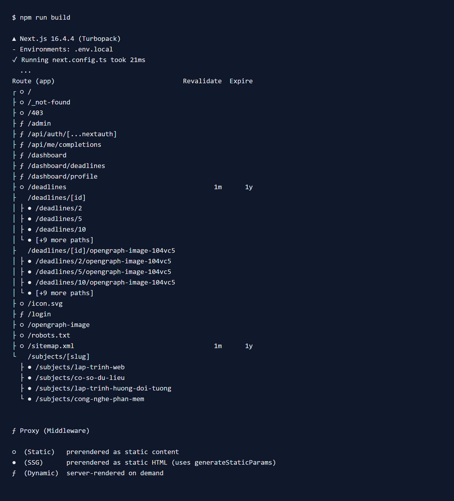
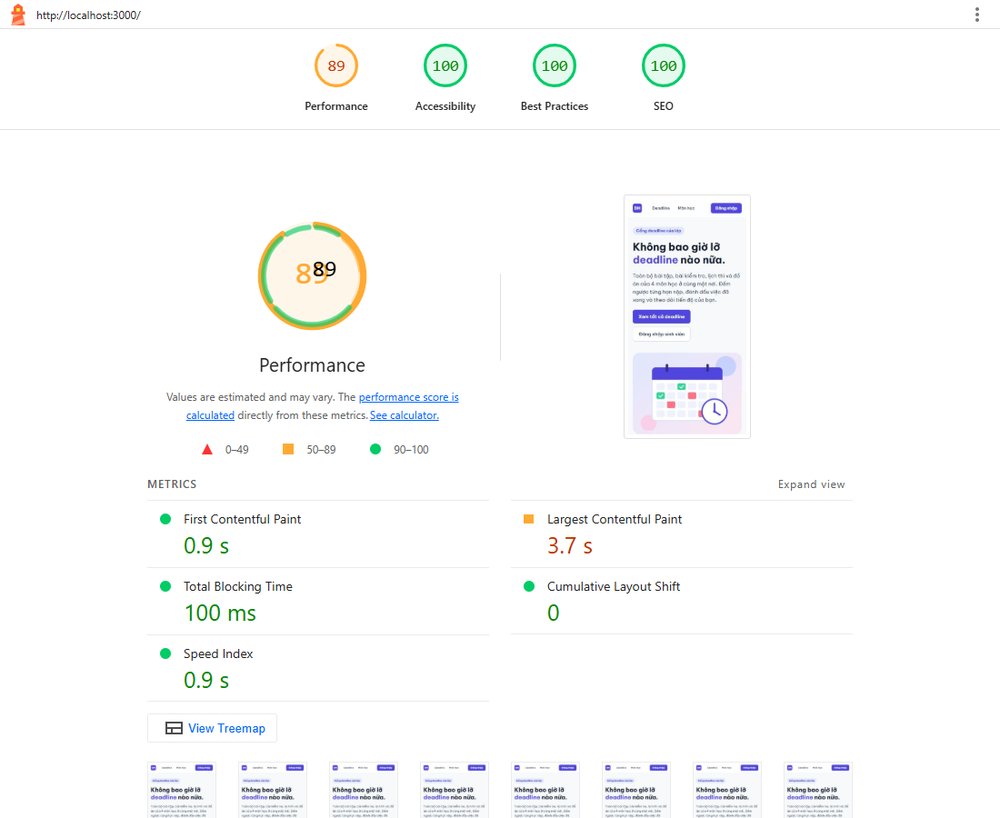
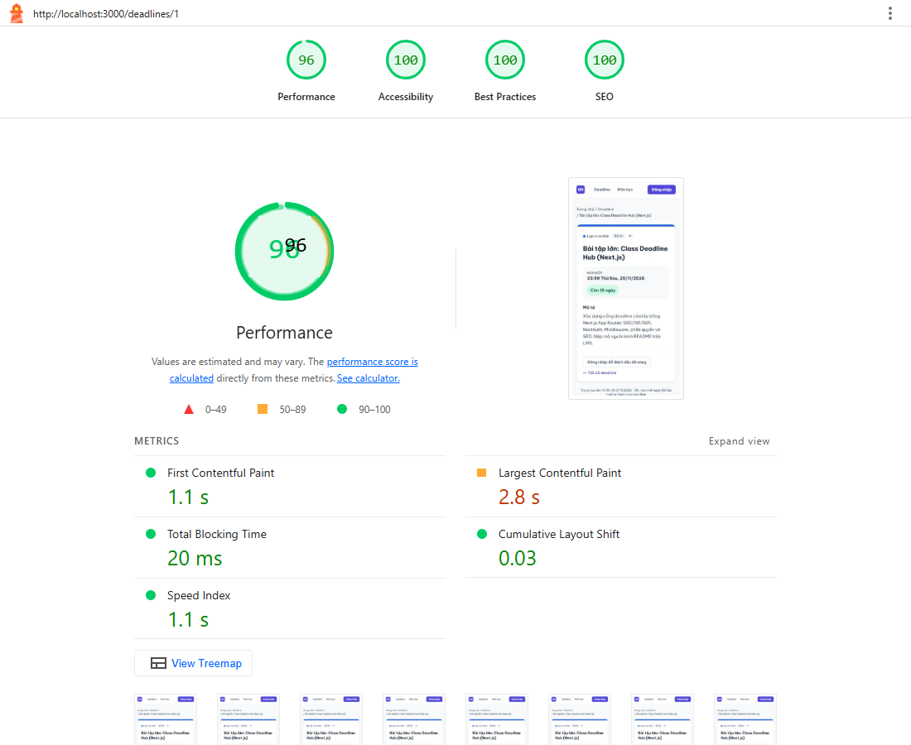
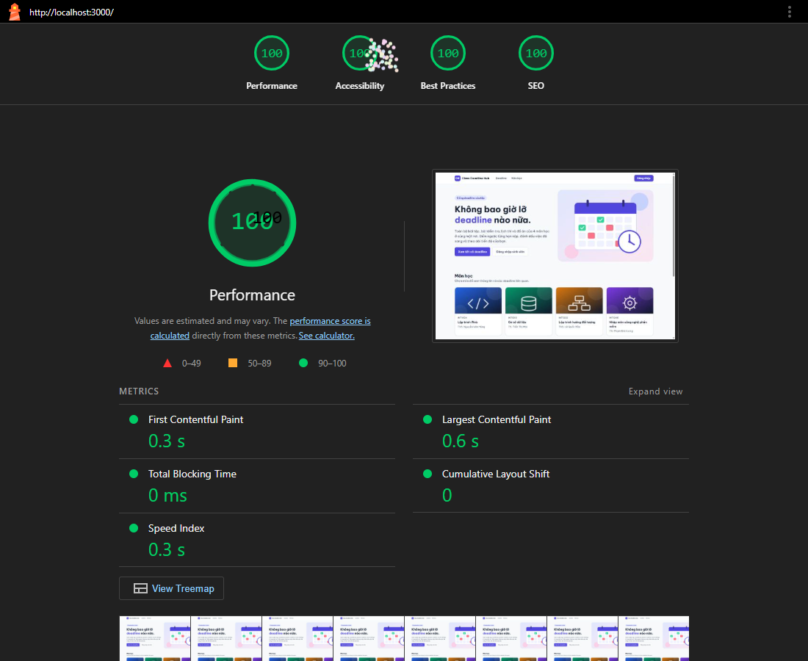
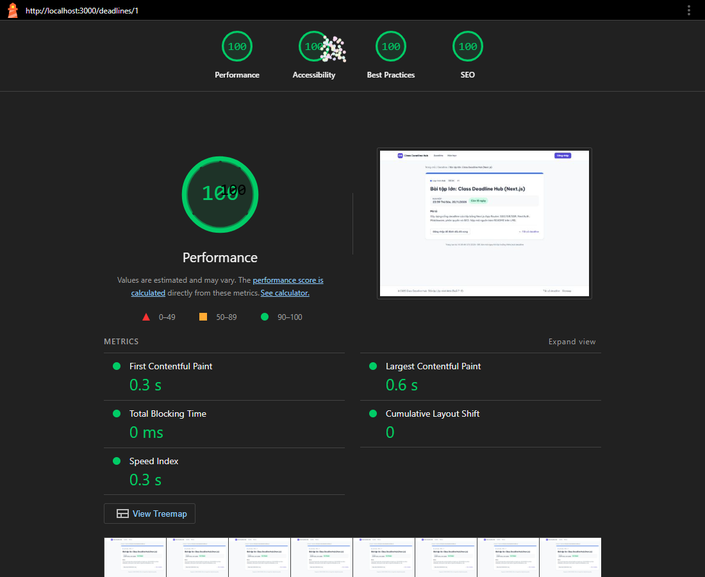
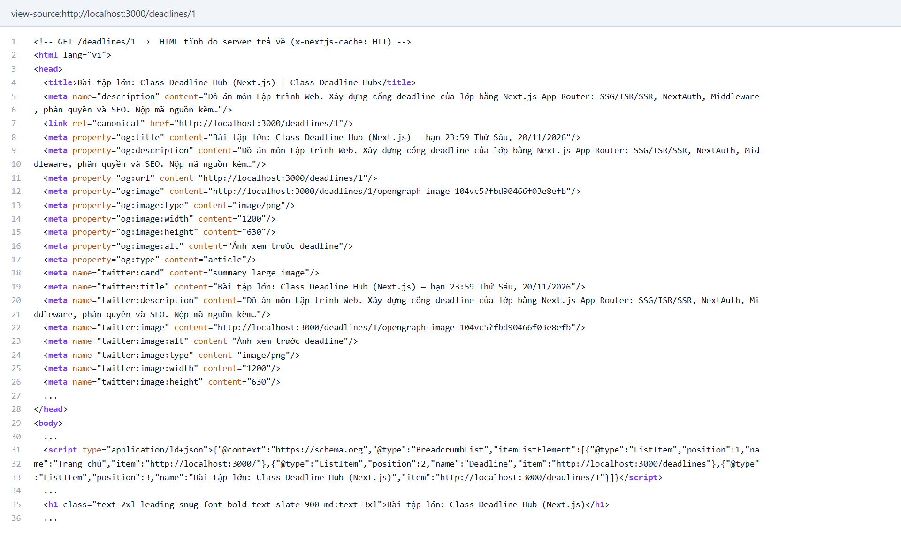

# Class Deadline Hub

Cổng web deadline của lớp, làm bằng **Next.js 16 (App Router)**, **Auth.js (NextAuth v5)**, TypeScript và Tailwind CSS 4.

- Ai cũng xem được deadline công khai; link chia sẻ có ảnh xem trước riêng cho từng deadline và Google tìm được (metadata, sitemap, JSON-LD).
- Sinh viên đăng nhập để đánh dấu deadline đã xong.
- Lớp trưởng (admin) thêm và xoá deadline.
- Dữ liệu lưu trong file JSON phía server (`data/`): 4 môn học, 12 deadline.

| Email | Mật khẩu | Vai trò |
| --- | --- | --- |
| `admin@ptit.edu.vn` | `admin123` | admin |
| `sv@ptit.edu.vn` | `sv123456` | user |

## 1. Cách chạy

Yêu cầu Node.js ≥ 20.

```bash
npm install
cp .env.example .env.local     # rồi điền AUTH_SECRET (xem bên dưới)
npm run dev                    # chế độ phát triển: http://localhost:3000
```

Tạo `AUTH_SECRET` (chuỗi bí mật ký JWT):

```bash
npx auth secret                # hoặc: openssl rand -base64 32
```

Chạy bản production (dùng để đo Lighthouse và kiểm tra ISR):

```bash
npm run build
npm run start                  # http://localhost:3000
```

Các lệnh khác: `npm test` (Jest cho `can()`), `npm run lint`, `npm run typecheck`.

> **Lưu ý:** `NEXT_PUBLIC_SITE_URL` quyết định domain trong sitemap, canonical, ảnh `og:image` và JSON-LD. Khi deploy hãy đặt bằng domain thật (mặc định `http://localhost:3000`).
>
> Dữ liệu ghi vào `data/*.json`, nên cần ổ đĩa ghi được. Trên Vercel hệ thống file là chỉ-đọc ở runtime, thao tác thêm/xoá/đánh dấu sẽ báo lỗi thân thiện thay vì làm sập trang; muốn dùng lâu dài cần chuyển sang một CSDL (xem mục "Hạn chế").

### Bật đăng nhập GitHub (điểm cộng)

Nút **Đăng nhập bằng GitHub** luôn hiển thị ở trang `/login`; nó bị vô hiệu hoá (kèm dòng hướng dẫn) cho tới khi bạn cấu hình OAuth:

1. GitHub → *Settings → Developer settings → OAuth Apps → New OAuth App*.
2. *Homepage URL*: `http://localhost:3000` — *Authorization callback URL*: `http://localhost:3000/api/auth/callback/github` (khi deploy thì đổi sang domain thật).
3. Tạo *Client secret*, rồi điền vào `.env.local`:

   ```
   AUTH_GITHUB_ID=<Client ID>
   AUTH_GITHUB_SECRET=<Client secret>
   ```

4. Chạy lại server. Người đăng nhập bằng GitHub có vai trò `user` (id dạng `github-<id>`).

### Biến môi trường

| Biến | Bắt buộc | Ý nghĩa |
| --- | --- | --- |
| `AUTH_SECRET` | có | Khoá ký JWT |
| `NEXT_PUBLIC_SITE_URL` | nên có | Domain công khai |
| `AUTH_GITHUB_ID`, `AUTH_GITHUB_SECRET` | không | Kích hoạt nút "Đăng nhập bằng GitHub" (điểm cộng). Callback URL: `<SITE_URL>/api/auth/callback/github` |

## 2. Kết quả `npm run build` và chiến lược render từng route



Ký hiệu: `○` static, `●` SSG (có `generateStaticParams`), `ƒ` dynamic (SSR). Cột *Revalidate* `1m` = làm mới sau 60 giây.

| Route | Truy cập | Chiến lược | Cài đặt | Vì sao chọn |
| --- | --- | --- | --- | --- |
| `/` | Mọi người | **SSG** | `export const dynamic = "force-static"` | Nội dung (giới thiệu, 4 môn, bảng quyền) gần như không đổi → build một lần, phục vụ từ CDN, nhanh và tốt cho SEO. |
| `/subjects/[slug]` | Mọi người | **SSG** | `generateStaticParams` + `dynamicParams = false` | Chỉ có 4 môn cố định → sinh sẵn 4 trang; slug lạ trả 404 ngay, không tốn tài nguyên render. |
| `/deadlines` | Mọi người | **ISR 60 giây** | `export const revalidate = 60` | Danh sách thay đổi khi admin thêm/xoá nhưng không cần tức thời đến từng giây; tĩnh + tự làm mới tối đa mỗi phút là cân bằng tốt giữa tốc độ và độ mới. |
| `/deadlines/[id]` | Mọi người | **ISR on-demand** | `revalidate = false` + `revalidatePath()` trong Server Action | Nội dung chỉ đổi khi admin thao tác → giữ HTML tĩnh vô thời hạn, làm mới **ngay** đúng trang bị ảnh hưởng. Xem câu hỏi (1). |
| `/dashboard` (+ `/deadlines`, `/profile`) | Đã đăng nhập | **SSR** | `dynamic = "force-dynamic"` + `auth()` | Nội dung theo từng người (tiến độ, việc đã xong) và theo cookie phiên → không thể cache chung. |
| `/admin` | Chỉ admin | **SSR** | `dynamic = "force-dynamic"` + `requirePagePermission()` | Dữ liệu quản trị phải luôn mới và phải kiểm tra quyền ở mỗi request. |

Id không tồn tại (`/deadlines/999`, `/deadlines/abc`) gọi `notFound()` → trả **HTTP 404** với trang 404 của dự án ([`src/app/not-found.tsx`](src/app/not-found.tsx)).

Phần "đếm ngược" (`Còn X ngày / Quá hạn Y ngày`) và bộ lọc là **Client Component** vì cần thời gian thực/tương tác của trình duyệt; HTML tĩnh chỉ chứa chỗ giữ "Đang tính…" nên không phụ thuộc thời điểm build. Mọi thành phần còn lại là Server Component.

## 3. Điểm Lighthouse (bản production, `npm run build && npm run start`)

Đo bằng Lighthouse 12 trên Chrome 156, máy cục bộ. Báo cáo đầy đủ: [`docs/lighthouse/`](docs/lighthouse/).

| Trang | Thiết bị | Performance | Accessibility | Best Practices | SEO | LCP | CLS | TBT |
| --- | --- | :-: | :-: | :-: | :-: | --- | --- | --- |
| `/` | Mobile | **89** | **100** | **100** | **100** | 3.7 s | 0 | 100 ms |
| `/` | Desktop | **100** | **100** | **100** | **100** | 0.6 s | 0 | 0 ms |
| `/deadlines/1` | Mobile | **96** | **100** | **100** | **100** | 2.8 s | 0.03 | 20 ms |
| `/deadlines/1` | Desktop | **100** | **100** | **100** | **100** | 0.6 s | 0 | 0 ms |

Điểm Performance mobile của `/` dao động khoảng 89–94 giữa các lần đo vì mô phỏng CPU chậm 4× và mạng 4G; LCP là ảnh hero (đã dùng `next/image` với `preload`, định dạng AVIF/WebP và `sizes`).

| `/` mobile | `/deadlines/1` mobile |
| --- | --- |
|  |  |
| `/` desktop | `/deadlines/1` desktop |
|  |  |

## 4. View-source của `/deadlines/1`

HTML do server trả về (không phải DOM sau hydrate): đã có sẵn `<title>`, meta description, canonical, Open Graph, Twitter Card, ảnh `og:image` riêng cho deadline, JSON-LD `BreadcrumbList` và nội dung `<h1>`, nên Google và các mạng xã hội đọc được mà không cần chạy JavaScript.



Toàn văn: [`docs/view-source-deadlines-1.html.txt`](docs/view-source-deadlines-1.html.txt).

## 5. Trả lời câu hỏi

### (1) Vì sao `/deadlines/[id]` dùng ISR?

- **Không dùng SSR**: nội dung trang chi tiết *giống nhau cho mọi người* (phần riêng của từng người như nút "Đã xong" được tải ở client). Render lại mỗi request là lãng phí CPU, tăng TTFB và làm Lighthouse/SEO kém hơn.
- **Không dùng SSG thuần**: deadline do admin thêm/xoá *sau khi build*. SSG thuần sẽ không có trang cho id mới (404) và vẫn hiển thị deadline đã xoá cho tới lần build sau.
- **ISR là điểm giữa**: lúc build sinh sẵn 12 trang tĩnh (nhanh, cache được ở CDN, crawler nhận HTML đầy đủ); id mới được render lần đầu khi có request rồi lưu lại (`dynamicParams = true`); và khi admin thêm/xoá, Server Action gọi `revalidatePath('/deadlines/<id>')` (kèm `/sitemap.xml`) nên trang được làm mới **ngay lập tức** thay vì chờ hết hạn. Deadline bị xoá chuyển thành 404 ngay.
- Dữ liệu chỉ đổi khi có thao tác của admin nên đặt `revalidate = false` (không hết hạn theo giờ) và chỉ làm mới theo sự kiện: tối ưu cả hiệu năng lẫn độ chính xác.

Đã kiểm thử bằng trình duyệt thật: admin thêm deadline #13 → `/deadlines/13` trả 200 ngay (trong khi `/deadlines` vẫn là bản cache 60 giây); xoá → `/deadlines/13` trả 404 ngay.

### (2) Nếu chỉ dùng Middleware để bảo vệ `/admin` thì có rủi ro gì?

Middleware chỉ là **một lớp lọc ở cửa**, không phải hàng rào duy nhất; dựa hoàn toàn vào nó thì:

1. **Server Action là endpoint POST công khai.** Ai cũng gửi được request trực tiếp kèm header `Next-Action` mà không qua trang `/admin`; nếu action không tự kiểm tra quyền thì kẻ tấn công thêm/xoá deadline được dù không thấy trang quản trị. (Dự án đã thử: sinh viên hoặc khách gọi trực tiếp `createDeadlineAction`/`deleteDeadlineAction` đều bị từ chối.)
2. **Cấu hình `matcher` sai hoặc sót.** Chỉ cần đổi cấu trúc route, thêm đường dẫn mới (`/admin-v2`, `/api/admin/...`), hay viết matcher thiếu là route lọt qua mà không ai hay biết.
3. **Lỗ hổng bỏ qua Middleware.** Đã có lỗ hổng thực tế (CVE-2025-29927 trong Next.js) cho phép bỏ qua Middleware bằng header `x-middleware-subrequest`; ứng dụng chỉ tin Middleware sẽ mất toàn bộ bảo vệ.
4. **Middleware chạy ở edge, chỉ có dữ liệu trong JWT**: không truy cập được dữ liệu server, khó áp dụng quy tắc nghiệp vụ chi tiết (vd. chủ sở hữu bản ghi), và JWT đã cấp vẫn còn hiệu lực dù quyền đổi sau đó.
5. **Mất lớp bảo vệ khi tái sử dụng code**: nếu một component/hàm dữ liệu nhạy cảm được dùng ở route khác, nó không còn Middleware che chắn.

**Cách dự án xử lý (phòng thủ nhiều lớp)**: Middleware ([`src/proxy.ts`](src/proxy.ts)) chặn sớm để UX tốt (chuyển `/login?callbackUrl=…` hoặc `/403`); **ngoài ra** trang `/admin` gọi `requirePagePermission("deadline:create")` và **mọi Server Action** gọi `checkActionPermission(...)` + kiểm tra dữ liệu bằng zod ([`src/lib/authz.ts`](src/lib/authz.ts), [`src/app/actions/deadlines.ts`](src/app/actions/deadlines.ts)). Tất cả đều dùng chung một hàm `can(role, action)`.

## 6. Cấu trúc & các quyết định chính

```
data/                  subjects.json, deadlines.json, users.json, completions.json
src/
  proxy.ts             Middleware (Next 16 đổi tên middleware.ts → proxy.ts)
  auth.ts, auth.config.ts   Auth.js: Credentials (+ GitHub tuỳ chọn), session JWT
  types/next-auth.d.ts      Khai báo kiểu: session.user.id và role: "user" | "admin"
  lib/permissions.ts   Ma trận phân quyền + can(role, action) — NƠI DUY NHẤT
  lib/permissions.test.ts   Jest cho can() (điểm cộng)
  lib/authz.ts         requirePagePermission (trang), checkActionPermission (action)
  lib/db.ts            Đọc/ghi JSON (server-only, ghi nguyên tử, tuần tự)
  lib/validation.ts    zod: đăng nhập, thêm deadline, id; chống open-redirect
  app/(public)/        / , /subjects/[slug], /deadlines, /deadlines/[id], /login, /403
  app/(app)/           /dashboard (layout lồng nhau + sidebar), /admin
  app/actions/         Server Actions (thêm, xoá, đánh dấu xong)
  app/sitemap.ts, robots.ts, opengraph-image.tsx
```

| Yêu cầu | Thực hiện |
| --- | --- |
| Route group `(public)` / `(app)` | Mỗi nhóm một `layout.tsx` riêng. `(public)` không đọc cookie nên trang vẫn tĩnh; `(app)` gọi `auth()` (SSR) và gắn `noindex`. |
| `/dashboard` có sidebar, tô sáng menu | [`dashboard/layout.tsx`](src/app/(app)/dashboard/layout.tsx) + [`SidebarNav`](src/components/SidebarNav.tsx) (`usePathname`, `aria-current="page"`). |
| `loading` / `error` ("Thử lại") / `not-found` | `loading.tsx` cho `/dashboard`, `/admin`; `error.tsx` ở cả hai nhóm dùng [`ErrorView`](src/components/ErrorView.tsx) (nút **Thử lại**); `global-error.tsx`; `not-found.tsx` toàn site. |
| `'use client'` tối thiểu | Chỉ: `Countdown`, `DeadlineFilter`, `UserMenu`, `SidebarNav`, `CompleteButton`, `LoginForm`, form admin, `Providers`, `ErrorView`. |
| NextAuth Credentials + JWT | [`src/auth.ts`](src/auth.ts); mật khẩu băm bcrypt; so sánh thời gian không đổi kể cả khi email không tồn tại. |
| `id`, `role` trong session | Callback `jwt`/`session` + [`next-auth.d.ts`](src/types/next-auth.d.ts); `role` có kiểu `UserRole = "user" \| "admin"`, không dùng `string`. |
| Header: tên, vai trò, Đăng nhập/Đăng xuất | [`UserMenu`](src/components/UserMenu.tsx). |
| Middleware | `/dashboard`, `/admin`: chưa đăng nhập → `/login?callbackUrl=<đường dẫn cũ>`; `user` vào `/admin` → `/403`. |
| Metadata động + ảnh chia sẻ | `generateMetadata` + [`opengraph-image.tsx`](src/app/(public)/deadlines/[id]/opengraph-image.tsx) (ảnh 1200×630 riêng từng deadline: màu theo môn, tiêu đề, hạn nộp, font Be Vietnam Pro). |
| Sitemap, robots | `sitemap.xml` gồm trang chủ, `/deadlines`, 4 môn và **mọi deadline**; `robots.txt` chặn `/dashboard`, `/admin`, `/api/`. |
| `/login`, `/dashboard` không lập chỉ mục | Thẻ `<meta name="robots" content="noindex">` **và** header `X-Robots-Tag`. `/login` cố ý *không* bị chặn trong robots.txt để Google đọc được thẻ `noindex`. |
| JSON-LD | `BreadcrumbList` ở `/deadlines/[id]` (đã escape `<`); `WebSite` ở trang chủ. |
| `next/font`, `next/image` | `Be_Vietnam_Pro` với subset `vietnamese`; ảnh hero và ảnh môn học dùng `next/image`. |

### Bảo mật đã áp dụng

- Server Action tự kiểm tra quyền + validate (zod): id chỉ nhận số nguyên dương; tiêu đề 5–120 ký tự; môn học phải tồn tại; loại thuộc danh sách; hạn nộp hợp lệ.
- `callbackUrl` chỉ chấp nhận đường dẫn nội bộ (chống open redirect).
- Hash mật khẩu bcrypt; thông báo đăng nhập sai không lộ email có tồn tại hay không.
- Ghi file JSON tuần tự và nguyên tử (ghi file tạm rồi `rename`).

## 7. Kiểm thử đã thực hiện

- `npm test`: 21 test Jest cho `can()`, `roleOf()` và `requiredActionFor()` (đủ 4 hành động × 3 vai trò, role lạ/`null` bị coi là guest).
- Kiểm thử đầu cuối bằng Chrome thật trên bản production (đăng nhập sai/đúng, quay lại `callbackUrl`, tô sáng menu, đánh dấu đã xong, `user` vào `/admin` → `/403`, admin thêm/xoá, ISR on-demand, 404, lỗi validate phía server).
- Gọi trực tiếp Server Action bằng HTTP với tư cách khách / sinh viên (bỏ qua giao diện và Middleware): đều bị từ chối.

